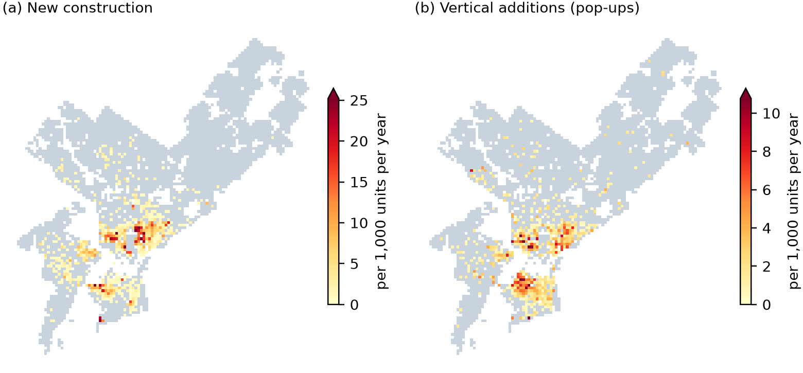

# Teaching Aerial Imagery to See Height: Tracking Philadelphia's Gentle Densification with LiDAR-Supervised Foundation Models

**Xuanyu Zhou · MUSA 6950 AI for Urban Sustainability · Final Project Proposal (revised 28 October 2026)**

## 1. Background and Research Questions

Adding homes inside the existing city is one of the most sustainable ways to grow. Infill and vertical additions use existing streets, transit and utilities, avoid greenfield development, and cut per-capita travel and energy use. Philadelphia's rowhouse neighborhoods densify one lot at a time: vacant lots are filled with new rowhouses, and existing homes gain an extra story ("pop-ups"). Pop-ups are contested enough that City Council has capped them in parts of the city; for example, Bill No. 230574 (2023) limits residential height in Brewerytown–Sharswood to that of the tallest abutting building [3]. Yet the city has no consistent, building-level record of *where* and *when* the built fabric grows. Permits record intent, not outcomes.

Airborne LiDAR measures building height directly, but Philadelphia flies it only every three to four years (most recently 2018, 2022 and 2025). Aerial imagery is flown every spring but contains no height. In Meta and WRI's Canopy Height Maps v2, a DINOv3 backbone pretrained on satellite imagery and supervised by LiDAR raised R² for tree height from 0.53 to 0.86 [1, 2]. This project uses the LiDAR flights as measured anchors and trains a model that reads from each year's imagery which buildings have grown since the last flight.

**Scope.** Residential and low/mid-density mixed-use zoning: 152.5 km² of current base districts, about 527,000 building units in 46 ZIP codes. The high-rise core (CMX-4/5), industrial and special-purpose districts and the Navy Yard are excluded.

- **RQ1 (AI):** How well can a LiDAR-anchored, bi-temporal DINOv3 model detect new construction and vertical additions from aerial imagery in places and years it has never seen, and at what spatial scale are its results reliable?
- **RQ2 (Urban):** Where, how much and *when* did Philadelphia densify through infill and vertical additions between 2018 and 2025, relative to transit access and neighborhood socioeconomic change?
- **RQ3 (Governance):** What share of building permits results in visible construction, how long does it take, and how much change happens without a matching permit?

## 2. Data Sources

| Data | Coverage | Role |
|---|---|---|
| City LiDAR point clouds (PASDA) [5] | Study area; 2018, 2022, 2025 (15–50 pts/m²); 2010, 2015 (sparse) | Building height, change labels, model anchors |
| City aerial orthoimagery (~0.23 m tiles, spring) | 2018–2020, 2022–2025 study area; 2010, 2015 training area | Model input |
| L&I building permits (Carto / OpenDataPhilly) [4] | 2014–2025, study area (257,160 records) | RQ3, label validation |
| Parcels (2016, 2025), building footprints (2017), zoning base districts [4] | Citywide | Analysis units, study-area mask |
| ACS 5-year estimates [6] and TIGER block groups | 2015–2019 and 2019–2023, Philadelphia block groups | Income and population change (RQ2) |
| SEPTA GTFS [7] | Current network | Distance to rail-type stops, bus stops (RQ2) |

The 2025 flight was on 18 April 2025 according to the point timestamps (PASDA's metadata repeats the 2022 date), so 2025 vegetation is also removed by point class.

## 3. Proposed AI Methods

**LiDAR change labels.** For each flight, 0.5 m normalized surface models are built and vegetation is removed. Rules flag new construction, vertical additions and demolition per building unit. On blind samples, 95.5% (pilot) and 95.7% (citywide) of flagged changes were real.

**LiDAR-anchored bi-temporal model.** A DINOv3 ViT-L/16 pretrained on satellite imagery (SAT-493M) encodes the anchor-year image and the target-year image. A DPT-style decoder fuses both feature maps and their difference with the anchor-year LiDAR height and vegetation. Features are pooled per building unit (mean and maximum, plus the share of the unit predicted to rise ≥ 2.5 m, which mirrors the LiDAR rule), and two heads score whether the unit *grew* and whether it is a *vertical addition*; a height-change regression is an auxiliary loss. Foundation-model features transfer across years and neighborhoods, the LiDAR anchor supplies the height the images lack, and the bi-temporal design measures change rather than a single state. The citywide model is trained on 10,559 image–LiDAR pairs from six periods (2010–2022) in 37 ZIP codes on a cloud GPU, with positive-pair oversampling, weight averaging (EMA) and a stop rule for collapsing runs. It then dates changes in the years between flights (2019, 2020, 2023, 2024).

**Evaluation.** Training, validation and test areas are separated by 1 km blocks and ZIP codes; the final test uses 8 sealed ZIP codes and the period 2022→2025, which never enters training. Decision rules (model selection, test metrics, when model estimates may be used) are written down and committed before results are seen, and the test is run once. Unit-level counts are calibrated with validation precision and recall and compared with LiDAR at 100 m, 250 m and block-group scale.

**Urban analysis.** Rates per 1,000 units per year (to handle different LiDAR coverage and period lengths), negative binomial regression by block group (transit distance, income level and change, population change), and permit-to-construction matching by parcel.

## 4. Expected Outcomes and Progress

| Outcome | Status (28 Oct 2026) |
|---|---|
| Final model and sealed test (RQ1) | Done. Test, 2022→2025: unit-level AP 0.68 for *grew*, 0.15 for vertical additions; correlation with LiDAR per 250 m cell 0.96 for new construction, 0.91 for *grew*, but 0.42 for vertical additions. As decided in advance, vertical additions are therefore reported only from LiDAR years, and new construction is dated by the model. |
| Densification maps 2018–2025 at 100 m, 250 m and block group (RQ2) | Done. On units covered by both LiDAR periods, new construction fell from 1.62 to 1.20 and pop-ups from 1.06 to 0.71 per 1,000 units per year (2018–22 vs 2022–25); 10% of 250 m cells hold 94% of new construction and 90% of pop-ups (Figure 1); almost none beyond 1.6 km of a rail-type stop; more growth where real income rose. |
| Permit analysis (RQ3) | Done. 61% of new-construction permits issued 2018–2020 show new construction by 2025, half within a year; 3.6–9.1% of detected changes have no related permit on the parcel. |
| Interactive web map (aggregated cells, no addresses) | Planned |
| Report, presentation, code repository | In progress; code and results on GitHub |

**Figure 1.** LiDAR-measured new construction (a) and vertical additions (b) per 250 m cell, 2018→2025, per 1,000 covered units per year (grey: none; color scale capped at the 99th percentile).

**Limitations.** Associations, not causal effects; ACS block-group margins are large; the 2018 flight is sparse outside the center (64% of units covered), so periods are compared on the same units.

## References

1. Meta AI and World Resources Institute (2026). *Canopy Height Maps v2.* https://ai.meta.com/blog/world-resources-institute-dino-canopy-height-maps-v2/
2. Siméoni, O., et al. (2025). *DINOv3.* arXiv:2508.10104.
3. City of Philadelphia, Bill No. 230574 (2023), Brewerytown–Sharswood overlay; *Philadelphia Inquirer*, 16 Nov 2023.
4. City of Philadelphia, L&I permits, parcels, footprints and zoning base districts, OpenDataPhilly.
5. PASDA, Philadelphia LiDAR and aerial photography, 2010–2025.
6. U.S. Census Bureau, American Community Survey 5-year summary files, 2015–2019 and 2019–2023.
7. SEPTA, GTFS public feed (2026).
